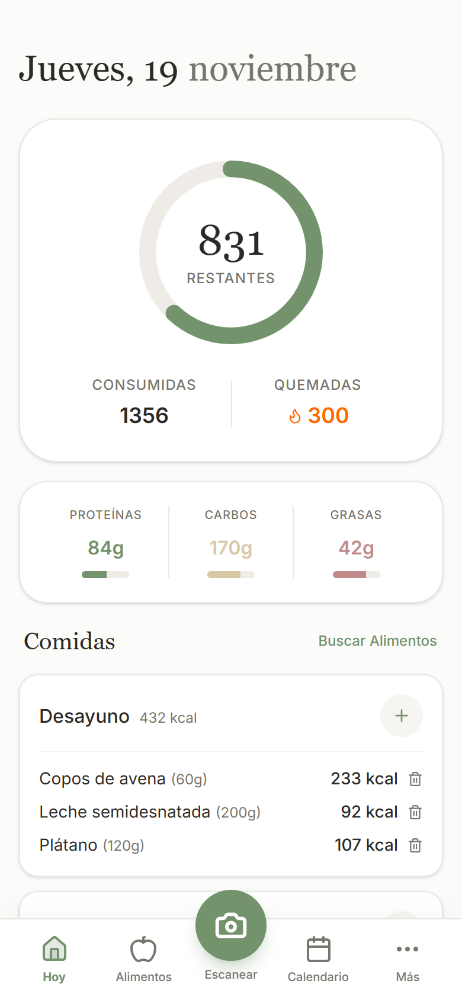
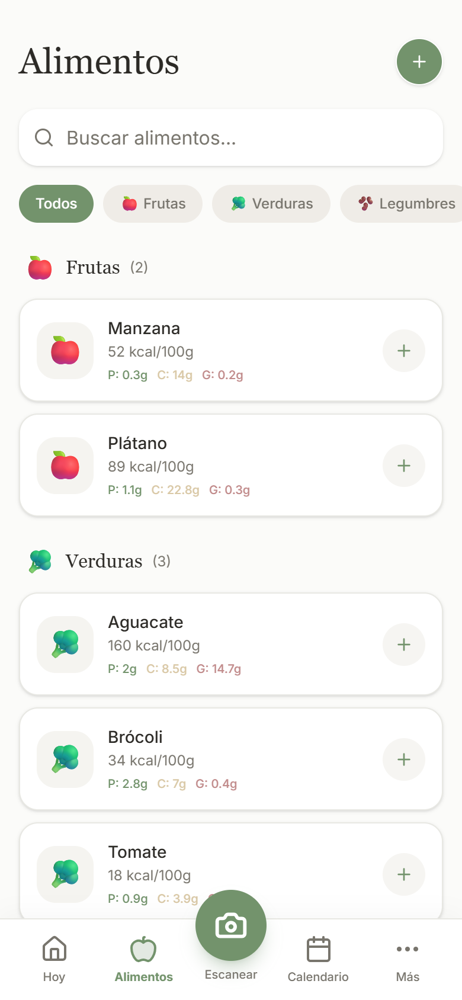
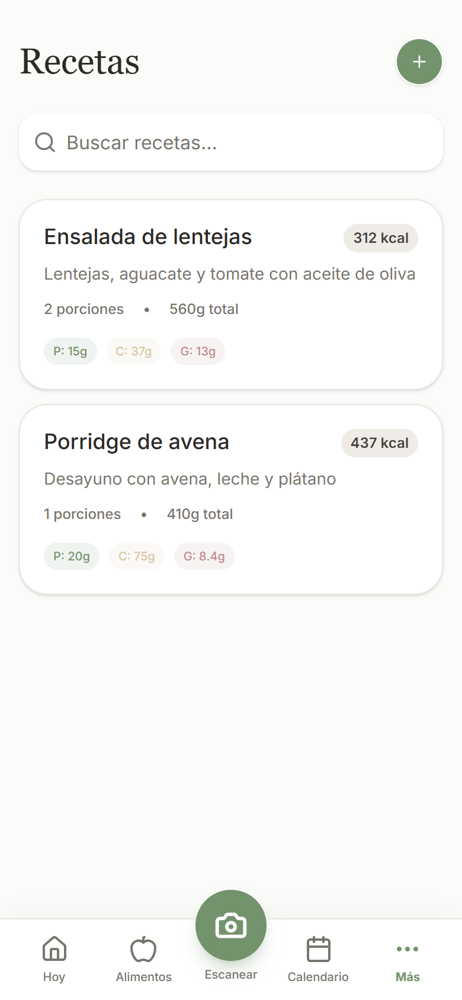
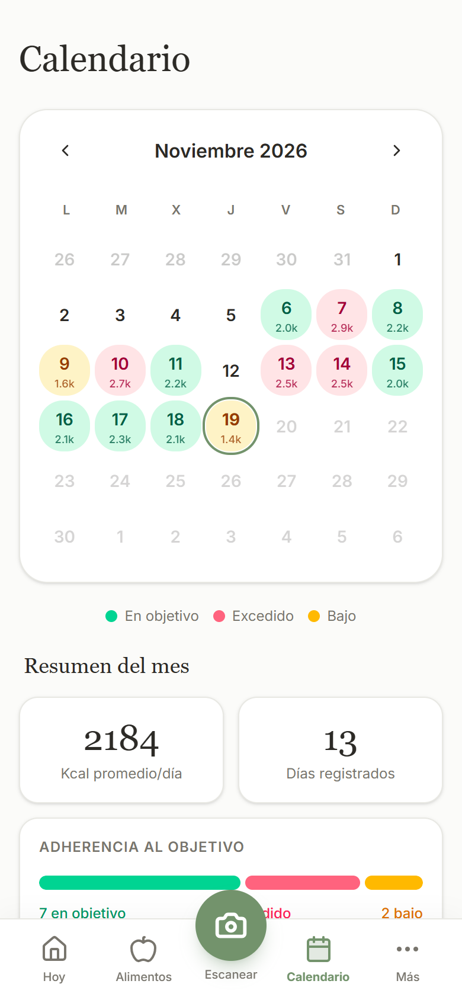
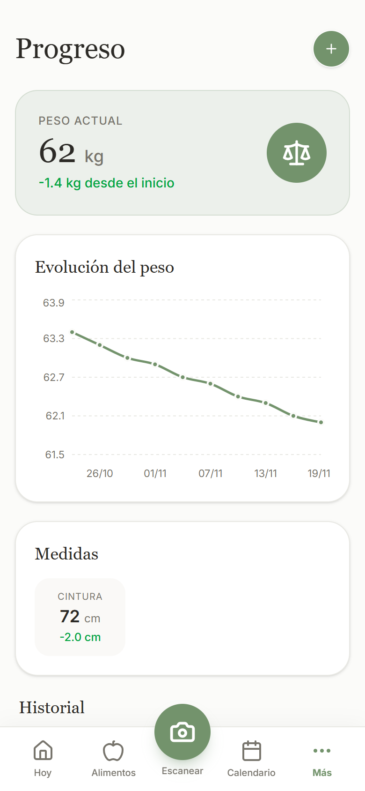
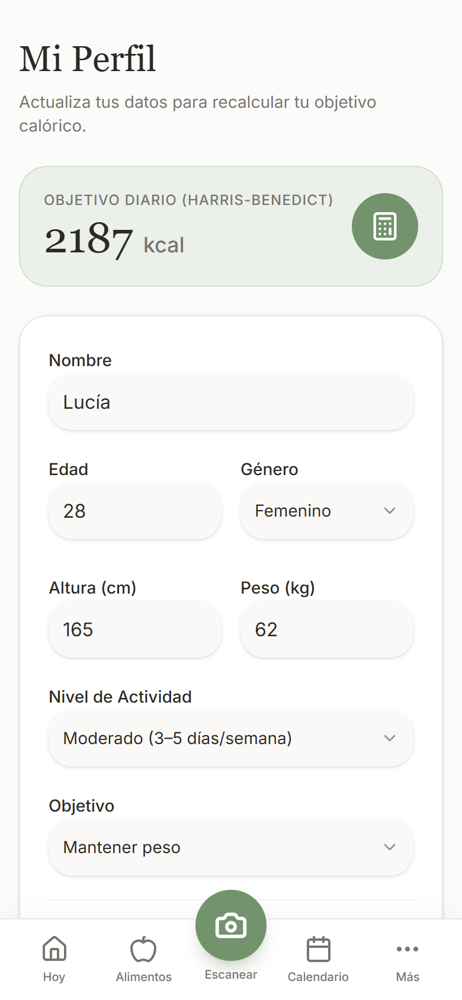
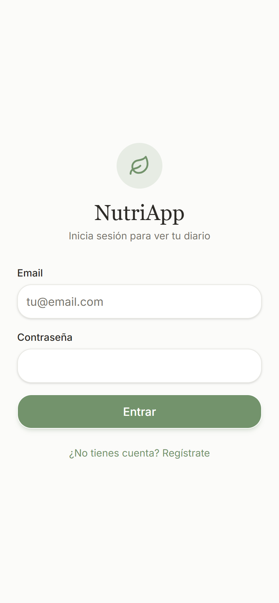

# NutriApp 🥗

> 🚧 **Work in progress.** The app started on Replit and is now developed locally. It hasn't been published yet.

A progressive web app (PWA) for tracking calories and nutrition, designed for iPhone and Android. The interface is fully in Spanish, with a pastel colour palette and navigation built for touch screens.

Built with the help of Replit's AI agent: I defined the features, reviewed the result and iterated on it.

## Features

- **Daily log**: 6 meal slots (desayuno, almuerzo, comida, merienda, cena, snacks)
- **Food database**: search, category filters with emojis, and a grouped view
- **Barcode scanner**: identifies packaged foods instantly with the camera (Open Food Facts)
- **AI photo analysis**: photograph a plate and the AI estimates calories and macros for each food (OpenAI GPT)
- **Custom recipes**: build recipes from foods in the database, with per-serving nutrition
- **Harris-Benedict calculator**: works out your calorie goal from your body data and activity level
- **Monthly calendar**: daily adherence with colour coding (green/amber/red) and your best streak
- **Exercise tracking**: log physical activity and calories burned
- **Weight tracking**: body weight history and chart
- **AI summaries**: weekly and monthly analysis with a score, observations and personalised recommendations
- **Statistics**: calorie, macro and weight progress charts

## Screenshots

Mobile-size screenshots with demo data. The app's interface is in Spanish.

| | | |
|:-:|:-:|:-:|
|  |  |  |
| **Today** (Hoy)<br>Calories left, today's macros and meals by slot | **Foods** (Alimentos)<br>Food database grouped by category | **Recipes** (Recetas)<br>Recipes with kcal and macros per serving |
|  |  |  |
| **Calendar** (Calendario)<br>Daily adherence to the goal, colour-coded | **Statistics** (Estadísticas)<br>Calories for the week and macro split | **Progress** (Progreso)<br>Weight over time |
|  |  |  |
| **Scan** (Escanear)<br>AI photo analysis and barcode scanning | **Profile** (Perfil)<br>Personal data and Harris-Benedict goal | **Sign in** (Acceso)<br>Log in and sign up |

## Tech stack

| Layer | Stack |
|-------|-------|
| Front end | React + Vite + TypeScript |
| UI | Tailwind CSS + shadcn/ui |
| Back end | Express 5 + Node.js |
| Database | PostgreSQL + Drizzle ORM |
| AI | OpenAI GPT (image analysis and summaries) |
| API | OpenAPI 3 + React Query (Orval codegen) |
| Monorepo | pnpm workspaces |

## Project structure

```
├── artifacts/
│   ├── calorie-tracker/     # React front end (PWA)
│   └── api-server/          # Express API back end
├── lib/
│   ├── api-client-react/    # Generated hooks (React Query)
│   ├── api-spec/            # OpenAPI spec + Orval config
│   ├── api-zod/             # Generated Zod schemas
│   ├── db/                  # Drizzle schema, migrations and PostgreSQL client
│   ├── shared/              # Food categories and macro maths (API and front end)
│   └── integrations-openai-ai-server/  # OpenAI client
└── scripts/                 # Utility scripts
```

## Local development

Requires Node.js 22.9+, pnpm 11+ and PostgreSQL 16 (with Docker, `pnpm db:up` is enough).

```bash
# 1. Install dependencies
pnpm install

# 2. Set up the environment
cp .env.example .env        # in PowerShell: Copy-Item .env.example .env

# 3. Database: start PostgreSQL and apply the migrations
pnpm db:up
pnpm db:migrate

# 4. Start the API and the front end, each in its own terminal
pnpm dev:api                # http://localhost:8080
pnpm dev:web                # http://localhost:5173
```

The front end calls `/api` and Vite proxies it to the API (`API_URL`, `http://localhost:8080` by default).

The Docker database listens on port 5433, so it doesn't clash with a PostgreSQL installed on the machine, which usually takes 5432.

After changing the OpenAPI spec:

```bash
pnpm --filter @workspace/api-spec run codegen
```

After changing the database schema (`lib/db/src/schema`):

```bash
pnpm db:generate   # creates the SQL migration in lib/db/migrations
pnpm db:migrate    # applies it to the database
```

Migrations are versioned in git; `drizzle-kit push` isn't used.

## PWA

The front end installs as an app: `vite-plugin-pwa` generates the manifest and a service worker (Workbox) that precaches the app and keeps the latest API reads so it can open offline. The PNG icons are in `artifacts/calorie-tracker/public/icons`. The service worker isn't registered in development; to test it:

```bash
pnpm --filter @workspace/calorie-tracker run build
pnpm --filter @workspace/calorie-tracker run serve   # http://localhost:5173 with a proxy to /api
```

## Accounts and sessions

Each user signs up with an email and password (scrypt hash) and gets an `httpOnly` session cookie valid for 30 days. All data (foods, recipes, diary, weight, profile) belongs to the session's user. With `SIGNUP_CODE` set, sign-up asks for that code.

## Environment variables

| Variable | Description |
|----------|-------------|
| `DATABASE_URL` | PostgreSQL connection string (required) |
| `PORT` | API port (8080 by default) |
| `OPENAI_API_KEY` | OpenAI key. Optional: without it, the AI features respond 503 |
| `OPENAI_MODEL` | OpenAI model (`gpt-5.1` by default) |
| `AI_DAILY_LIMIT` | AI calls per user per day (20 by default) |
| `SIGNUP_CODE` | Optional: code required to sign up |
| `CORS_ORIGIN` | Optional: allowed origins if the front end lives on another domain |

## Status and deployment

The app runs locally, with PostgreSQL in Docker. It doesn't have a published version yet.

## Next steps

- [x] User accounts and sessions
- [x] Daily AI usage limit
- [x] Installable PWA with a service worker
- [ ] Deploy the API, database and front end to a host
- [ ] Add recipes to the diary from the interface (the API already supports it)
- [ ] Store food photos in file storage
<!-- Add your planned improvements here -->

## API routes

Every route except `/api/healthz` and `/api/auth/*` requires a logged-in session.

| Method | Route | Description |
|--------|-------|-------------|
| POST | `/api/auth/register` | Create an account and log in |
| POST | `/api/auth/login` | Log in |
| POST | `/api/auth/logout` | Log out |
| GET | `/api/auth/me` | The session's user |
| GET | `/api/foods` | List foods (with filters) |
| POST | `/api/foods` | Create a food |
| GET | `/api/logs/:date` | The day's log |
| POST | `/api/logs/:date/entries` | Add an entry to the log |
| GET | `/api/dashboard/today` | Today's summary |
| GET | `/api/dashboard/calendar/:year/:month` | Month view |
| GET | `/api/dashboard/stats/weekly` and `/monthly` | 7- and 30-day statistics |
| GET | `/api/profile` | The user's profile |
| PUT | `/api/profile` | Update the profile |
| GET/POST | `/api/weight` | Weight logs |
| GET/POST | `/api/exercises` | Exercises |
| GET/POST | `/api/recipes` | Recipes |
| POST | `/api/ai/analyze-image` | AI photo analysis |
| GET | `/api/ai/weekly-summary` | Weekly AI summary |
| GET | `/api/ai/monthly-summary` | Monthly AI summary |
| GET | `/api/ai/usage` | Today's AI usage and limit |

The full contract, including error responses, is in [`lib/api-spec/openapi.yaml`](lib/api-spec/openapi.yaml).

## License

© Victoria Carbonell Sánchez. All rights reserved.

This repository is public as a sample of my work. No permission is granted to use, modify or distribute the code. Third-party dependencies and components keep their own licenses. See [LICENSE](LICENSE).
