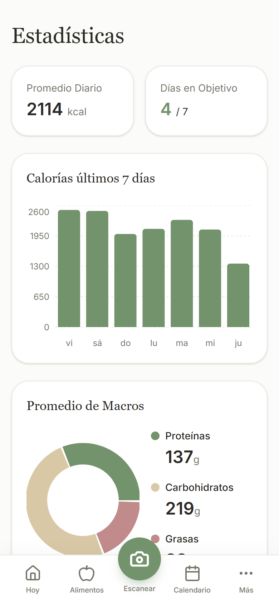
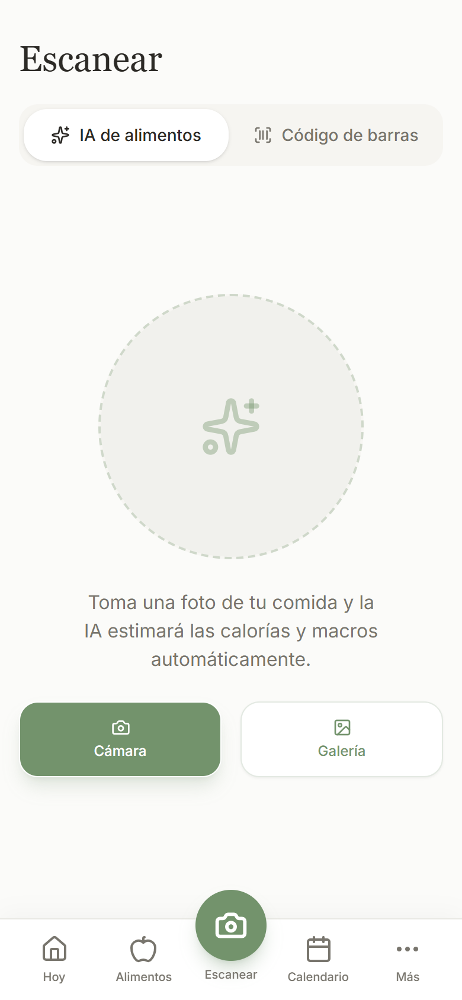

# NutriApp 🥗

> 🚧 **Proyecto en curso.** La app nació en Replit y ahora se desarrolla en local. Todavía no está publicada.

Aplicación móvil progresiva (PWA) para el seguimiento de calorías y nutrición, diseñada para iPhone y Android. Interfaz completamente en español con paleta de colores pastel y navegación optimizada para pantallas táctiles.

Desarrollada con ayuda del agente de IA de Replit: yo definí las funcionalidades, revisé el resultado y fui iterando sobre él.

## Características

- **Registro diario** — 6 franjas horarias de comida (desayuno, almuerzo, comida, merienda, cena, snacks)
- **Base de datos de alimentos** — búsqueda, filtrado por categoría con emojis y vista agrupada
- **Escáner de código de barras** — identifica alimentos al instante con la cámara
- **Análisis IA de fotos** — fotografía un plato y la IA estima las calorías y macros (powered by OpenAI GPT)
- **Recetas personalizadas** — crea tus propias recetas con ingredientes de la base de datos
- **Calculadora Harris-Benedict** — calcula tu objetivo calórico según tus datos físicos y nivel de actividad
- **Calendario mensual** — visualiza tu adherencia diaria con código de colores (verde/ámbar/rojo)
- **Seguimiento de ejercicio** — registra actividad física y calorías quemadas
- **Seguimiento de peso y medidas** — historial de peso corporal y medidas
- **Resúmenes IA** — análisis semanal y mensual con puntuación, observaciones y recomendaciones personalizadas
- **Estadísticas** — gráficos de progreso de calorías, macros y peso

## Capturas

Capturas en tamaño móvil con datos de demostración.

| | | |
|:-:|:-:|:-:|
|  |  |  |
| **Hoy**<br>Calorías restantes, macros del día y comidas por franja | **Alimentos**<br>Base de alimentos agrupada por categoría | **Recetas**<br>Recetas con kcal y macros por porción |
|  |  |  |
| **Calendario**<br>Adherencia diaria al objetivo por colores | **Estadísticas**<br>Calorías de la semana y reparto de macros | **Progreso**<br>Evolución del peso |
|  |  |  |
| **Escanear**<br>Análisis de fotos con IA y código de barras | **Perfil**<br>Datos personales y objetivo Harris-Benedict | **Acceso**<br>Inicio de sesión y registro |

## Tecnología

| Capa | Stack |
|------|-------|
| Frontend | React + Vite + TypeScript |
| UI | Tailwind CSS + shadcn/ui |
| Backend | Express 5 + Node.js |
| Base de datos | PostgreSQL + Drizzle ORM |
| IA | OpenAI GPT (análisis de imagen y resúmenes) |
| API | OpenAPI 3 + React Query (Orval codegen) |
| Monorepo | pnpm workspaces |

## Estructura del proyecto

```
├── artifacts/
│   ├── calorie-tracker/     # Frontend React (PWA)
│   └── api-server/          # Backend Express API
├── lib/
│   ├── api-client-react/    # Hooks generados (React Query)
│   ├── api-spec/            # Especificación OpenAPI + Orval config
│   ├── api-zod/             # Schemas Zod generados
│   ├── db/                  # Schema Drizzle, migraciones y cliente PostgreSQL
│   ├── shared/              # Categorías de alimentos y cálculo de macros (API y front)
│   └── integrations-openai-ai-server/  # Cliente OpenAI
└── scripts/                 # Scripts de utilidad
```

## Desarrollo local

Requiere Node.js 22.9+, pnpm 10+ y PostgreSQL 16 (con Docker basta `pnpm db:up`).

```bash
# 1. Instalar dependencias
pnpm install

# 2. Configurar el entorno
cp .env.example .env        # en PowerShell: Copy-Item .env.example .env

# 3. Base de datos: arrancar PostgreSQL y aplicar las migraciones
pnpm db:up
pnpm db:migrate

# 4. Arrancar API y front, cada uno en una terminal
pnpm dev:api                # http://localhost:8080
pnpm dev:web                # http://localhost:5173
```

El front llama a `/api` y Vite lo redirige al API (`API_URL`, por defecto `http://localhost:8080`).

Tras cambiar la especificación OpenAPI:

```bash
pnpm --filter @workspace/api-spec run codegen
```

Tras cambiar el esquema de la base de datos (`lib/db/src/schema`):

```bash
pnpm db:generate   # crea la migración SQL en lib/db/migrations
pnpm db:migrate    # la aplica a la base de datos
```

Las migraciones se versionan en git; no se usa `drizzle-kit push`.

## PWA

El front se instala como aplicación: `vite-plugin-pwa` genera el manifest y un service worker (Workbox) que precachea la app y guarda las últimas lecturas del API para abrirla sin conexión. Los iconos PNG están en `artifacts/calorie-tracker/public/icons`. En desarrollo el service worker no se registra; para probarlo:

```bash
pnpm --filter @workspace/calorie-tracker run build
pnpm --filter @workspace/calorie-tracker run serve   # http://localhost:5173 con proxy a /api
```

## Cuentas y sesiones

Cada usuario se registra con email y contraseña (hash scrypt) y recibe una cookie de sesión `httpOnly` válida 30 días. Todos los datos (alimentos, recetas, diario, peso, perfil) pertenecen al usuario de la sesión. Con `SIGNUP_CODE` definido, el registro pide ese código.

## Variables de entorno

| Variable | Descripción |
|----------|-------------|
| `DATABASE_URL` | Cadena de conexión PostgreSQL (obligatoria) |
| `PORT` | Puerto del API (por defecto 8080) |
| `OPENAI_API_KEY` | Clave de OpenAI. Opcional: sin ella, las funciones de IA responden 503 |
| `OPENAI_MODEL` | Modelo de OpenAI (por defecto `gpt-5.1`) |
| `AI_DAILY_LIMIT` | Llamadas a la IA por usuario y día (por defecto 20) |
| `SIGNUP_CODE` | Opcional: código necesario para registrarse |
| `CORS_ORIGIN` | Opcional: orígenes permitidos si el front vive en otro dominio |

## Estado y despliegue

La app se ejecuta en local, con PostgreSQL en Docker. Todavía no tiene una versión publicada.

## Próximos pasos

- [x] Cuentas de usuario y sesiones
- [x] Límite diario de uso de la IA
- [x] PWA instalable con service worker
- [ ] Desplegar API, base de datos y front en un hosting
- [ ] Añadir recetas al diario desde la interfaz (el API ya lo permite)
- [ ] Guardar las fotos de los alimentos en un almacenamiento de ficheros
<!-- Añade aquí las mejoras que tengas pensadas -->

## Rutas de la API

Salvo `/api/healthz` y `/api/auth/*`, todas exigen sesión iniciada.

| Método | Ruta | Descripción |
|--------|------|-------------|
| POST | `/api/auth/register` | Crear cuenta e iniciar sesión |
| POST | `/api/auth/login` | Iniciar sesión |
| POST | `/api/auth/logout` | Cerrar sesión |
| GET | `/api/auth/me` | Usuario de la sesión |
| GET | `/api/foods` | Listado de alimentos (con filtros) |
| POST | `/api/foods` | Crear alimento |
| GET | `/api/logs/:date` | Registro del día |
| POST | `/api/logs/:date/entries` | Añadir entrada al registro |
| GET | `/api/dashboard/today` | Resumen del día actual |
| GET | `/api/dashboard/calendar/:year/:month` | Vista mensual |
| GET | `/api/dashboard/stats/weekly` y `/monthly` | Estadísticas de 7 y 30 días |
| GET | `/api/profile` | Perfil del usuario |
| PUT | `/api/profile` | Actualizar perfil |
| GET/POST | `/api/weight` | Registros de peso |
| GET/POST | `/api/exercises` | Ejercicios |
| GET/POST | `/api/recipes` | Recetas |
| POST | `/api/ai/analyze-image` | Análisis de foto con IA |
| GET | `/api/ai/weekly-summary` | Resumen semanal IA |
| GET | `/api/ai/monthly-summary` | Resumen mensual IA |
| GET | `/api/ai/usage` | Usos de IA de hoy y límite |
